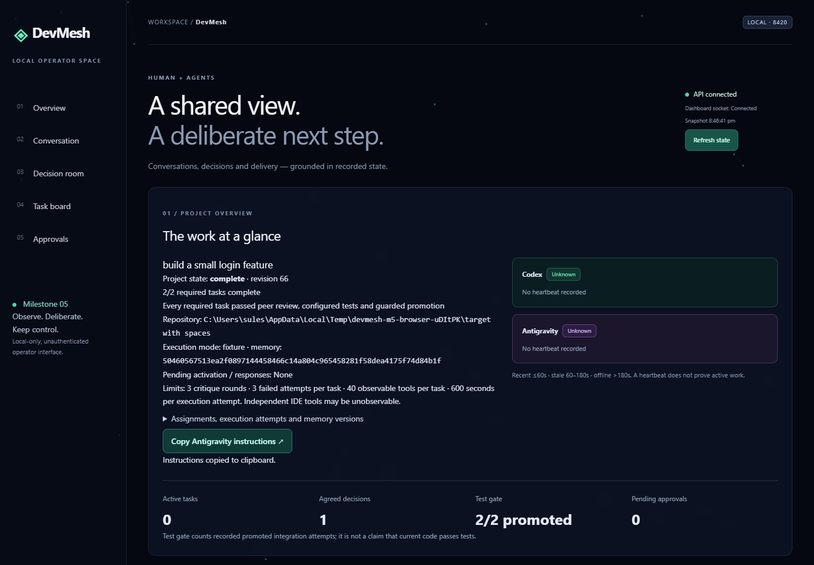
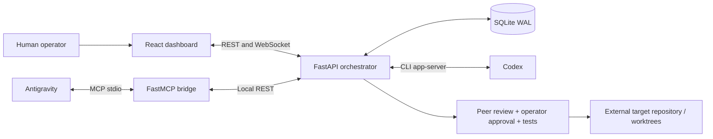

# DevMesh

**Two agents. Recorded decisions. Human control.**

[](https://github.com/suleshcreates/DevMesh/actions/workflows/ci.yml)
[](https://m8ven.ai/mcp/suleshcreates-devmesh-n9jmq1?s=readme)

DevMesh is a Windows-first local workspace for coordinating **Codex** and **Google Antigravity**. It brings durable messaging, structured peer critique, scoped Git worktrees, test gates, and human approvals into one operator dashboard.

> **Status: experimental, through Milestone 5.** Production editing uses an explicit manual worktree/commit handoff. Real-agent M5 end-to-end execution and indefinite IDE polling remain unverified.



*Dashboard captured during a disposable automated fixture run; inference was simulated.*

## What it does

- **Keeps work durable:** SQLite in WAL mode stores messages, decisions, tasks, approvals, and project lifecycle state. Messages leave the pending inbox only after acknowledgement.
- **Makes disagreement visible:** proposals and typed peer critiques converge through a deterministic decision engine, with bounded rounds and escalation to the operator.
- **Connects IDE agents:** an official FastMCP stdio bridge exposes inbox, context, critique, and lifecycle reporting tools.
- **Protects integration:** exact-commit peer review, operator approval of the test action, successful tests, and guarded Git promotion are separate gates.
- **Shows recorded state:** a React dashboard presents conversations, decisions, tasks, approvals, and project progress with reconnect handling.
- **Preserves project memory:** Markdown documents are generated atomically from SQLite; editing those files does not change authoritative state.

## How it fits together



The operator selects a separate target repository and a test command. Both agents analyze the goal, critique each other's designs, and establish recorded project memory. Task execution pauses for manual edits and an actual commit in the assigned worktree. Peer review and the operator's exact-action approval precede testing and promotion.

## Requirements

- Windows and PowerShell; Python **3.11+**; Git; Node.js **22+** and npm.
- Codex CLI authenticated through its own supported sign-in flow.
- Antigravity with the DevMesh MCP bridge registered in its active configuration.

No paid model API keys are required by DevMesh. It never reads Codex authentication files. Your agent account limits still apply. The verified local Codex model was `gpt-6-astra`; availability depends on your account and installed CLI.

## Quick start

```powershell
git clone https://github.com/suleshcreates/DevMesh.git
Set-Location DevMesh
$activeMcpConfig = Read-Host 'Active MCP config path confirmed in Antigravity settings'
.\start_devmesh.ps1 -McpConfigPath $activeMcpConfig
```

The launcher checks prerequisites, prepares dependencies, starts the local API and dashboard, and prints activation instructions. The MCP path is checked for existence only; registration must be verified manually. A full cold-bootstrap launcher run remains a manual verification item.

| Surface | Address |
| --- | --- |
| Dashboard | http://localhost:5173 |
| API | http://127.0.0.1:8420 |
| API schema | http://127.0.0.1:8420/docs |

Manually add only the following entry to the existing `mcpServers` object, replacing the paths with your clone's absolute paths:

```json
"devmesh-bridge": {
  "command": "C:\\DevMesh\\.venv\\Scripts\\python.exe",
  "args": ["C:\\DevMesh\\mcp_bridge\\devmesh_mcp.py"]
}
```

Refresh the bridge, start a project, then paste **Copy Antigravity instructions** from the dashboard into the IDE. If the IDE stops polling, re-paste the current project prompt.

**First run:** use the disposable lab in the [M5 runbook](docs/MILESTONE5.md#disposable-real-agentmanual-verification). Do not select the DevMesh repository itself as the execution target. The current design supports one project per database, including after completion or cancellation.

## Development and verification

```powershell
python -m venv .venv
.\.venv\Scripts\python.exe -m pip install -r requirements-m1.lock.txt
.\.venv\Scripts\python.exe -m pytest -q
.\.venv\Scripts\python.exe -m pip check
Set-Location frontend
npm.cmd ci
npm.cmd test
npm.cmd run build
```

The M5 verification record reports **147 backend tests**, **3 frontend tests**, and **17 Edge scenarios** passing. Browser and automated lifecycle checks inject fake inference adapters while using real disposable commits, configured tests, and integration gates. These results do not establish a real two-agent end-to-end pass. See [verification evidence](docs/m5-verification-results.json) and [the complete runbook](docs/MILESTONE5.md).

## Safety and current limits

This is a trusted, local, single-process tool. Agent and operator labels are unauthenticated. Keep both services local; do not expose them to the internet. Worktree scope checks and pattern-based secret redaction are cooperative controls, not an OS sandbox or comprehensive data-loss prevention system. Approved test commands run with ordinary user privileges.

Execution budgets are bounded: **3 critique rounds per decision, 3 task retries, 40 observable tool calls per task, and 600 seconds per active execution attempt**. Independent IDE activity may not be fully observable. Interrupted or uncertain execution pauses for inspection rather than blind replay.

## Project map

| Path | Responsibility |
| --- | --- |
| `backend/` | API, persistence, deliberation, task safety, orchestration |
| `mcp_bridge/` | MCP tools backed by local domain services |
| `frontend/` | React, TypeScript, Vite, Tailwind dashboard |
| `scripts/` | Integration spikes, disposable labs, activation helpers |
| `tests/` | Protocol, API, persistence, recovery, safety, lifecycle tests |
| `docs/` | Feasibility, milestone runbooks, verification records |

Start with [feasibility](docs/FEASIBILITY.md), [M5 operations](docs/MILESTONE5.md), [contributing](CONTRIBUTING.md), and [security](SECURITY.md).

Historical evidence retains machine-specific paths and manual test identifiers. Adapt setup paths to your installation. No open-source license has been selected; public visibility alone does not grant a software license.
